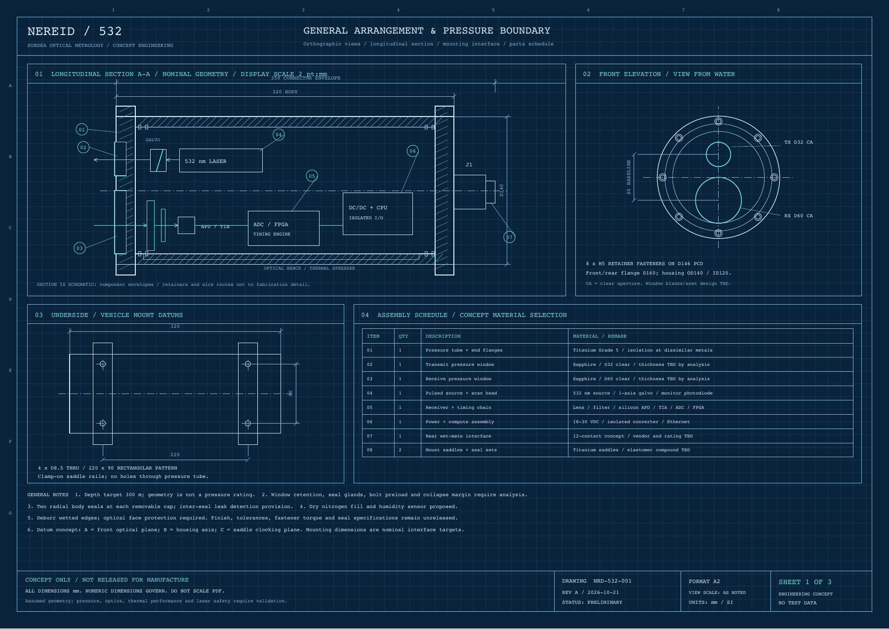

# Narwhal Two Plus

**A documented research concept for a 532 nm underwater scanning LiDAR, with executable reference software.**



Narwhal Two Plus brings together a proposed pressure-housed sensor, optical and electrical architecture, range-reconstruction mathematics, engineering drawings, and a reproducible software experiment. The drawing assembly retains its original identifier **NEREID-532, revision A**; Narwhal Two Plus is the repository and project name.

**Maturity: concept design and numerical reference implementation.** No sensor has been built, pressure tested, calibrated, or demonstrated. The 300 m depth, 1-15 m range, and 20 mm precision values are engineering objectives. This repository is a technical design record, not a peer-reviewed paper or a manufacturing release.

## Start here

| Resource | Contents |
|---|---|
| [Technical report](docs/technical-report.md) | Abstract, design rationale, equations, reproducible methods, computed results, uncertainty, limitations and references |
| [Blueprint drawing set](hardware/drawings/NEREID-532_concept_blueprint.pdf) | Three A2 vector sheets: mechanical arrangement, system architecture, sensor data |
| [Separate sensor-data sheet](hardware/drawings/NEREID-532_sensor_data.pdf) | Specifications, calculations, output fields and acceptance plan |
| [Hardware specification](hardware/README.md) | Mechanical interfaces, bill of materials, optical/power allocation and unresolved design work |
| [Software guide](docs/software.md) | Installation, commands, raw-event schema, module descriptions and examples |
| [Proposed packet specification](docs/protocol.md) | Exact 40-byte point layout, framing, CRC, units and quality flags |
| [Verification record](docs/verification.md) | Tests performed, synthetic experiment, evidence boundaries and release gates |
| [Development roadmap](docs/roadmap.md) | Work required to progress from this reference to real hardware |

## Run it now

Python 3.10 or newer is required. The reference software uses the Python standard library only. From the repository root:

```bash
PYTHONPATH=src python3 -m narwhal --config config/concept.json simulate --out runs/demo --lines 2 --seed 532
PYTHONPATH=src python3 -m narwhal --config config/concept.json replay runs/demo.raw.jsonl --out runs/replay
PYTHONPATH=src python3 -m narwhal metrics
PYTHONPATH=src python3 -m unittest discover -s tests -v
```

Each scan writes raw returns (simulation only), reconstructed JSONL, CSV, ASCII PLY and a metadata sidecar. Open the `.ply` in a point-cloud viewer. The two default scan lines repeat a stationary plane; vehicle navigation and motion compensation are not simulated. Invalid returns remain in CSV/JSONL and are omitted from PLY.

For an installed CLI in an isolated environment:

```bash
python3 -m venv .venv
source .venv/bin/activate
python3 -m pip install -e .
narwhal --config config/concept.json simulate --out runs/demo
```

The install step uses setuptools as its packaging dependency; runtime has no third-party dependencies. On Windows PowerShell, use `$env:PYTHONPATH="src"` before the commands or use the installed CLI.

## What the software actually does

- Generates deterministic synthetic returns from a planar target with configurable timing jitter and dropout.
- Reconstructs range using an exact homogeneous-water bistatic ray/ellipsoid intersection, including the 60 mm TX/RX baseline.
- Replays measured-delay event files using supplied calibration constants.
- Exports points with timestamp, range, angle, intensity, line number and explicit provenance/quality flags.
- Encodes and checks a proposed binary point format, including packet CRC and malformed-input rejection.
- Receives bounded captures of that proposed format over UDP, defaulting to localhost.
- Computes the first-order timing, scanning and hydrostatic calculations documented in the report.

**Hardware operation is not implemented.** There is no FPGA bitstream, MCU firmware, component-specific driver, waveform estimator, galvo control, laser-enable command, calibration solution, or verified physical device protocol. The UDP receiver is a tested reference interface; no existing sensor is claimed to support it. See the [hardware integration plan](docs/roadmap.md).

## Proposed sensor, at a glance

| Parameter | Concept objective / assumption |
|---|---|
| Measurement | Pulsed direct time of flight, bistatic TX/RX |
| Optical source | 532 nm, 2 ns pulses, 5 microjoules at 20 kHz |
| In-water scan field | 30 degrees, one scanned axis |
| Receive window / baseline | 60 mm clear aperture / 60 mm vertical center spacing |
| Range / precision objective | 1-15 m clear water / 20 mm 1 sigma at 5 m under defined test conditions |
| Depth objective | 300 m; pressure boundary unverified |
| Housing envelope | 160 mm maximum flange diameter; 320 mm body; 359 mm with connector |
| Electrical budget | 18-30 VDC; 35 W nominal, 60 W peak assumed |
| External interface concept | 100BASE-TX Ethernet, differential PPS, isolated enable and RS-485 service |
| Current evidence | Drawings, first-order calculations, synthetic data and software tests |

All optical, thermal and pressure numbers need component selection and testing. Phase index (1.333) and group index (1.34) are separate fixed example inputs; they are not a temperature/salinity model.

## Repository structure

```text
config/                 Versioned concept/calibration assumptions
src/narwhal/            Simulation, geometry, replay, wire codec and CLI
hardware/drawings/      Original vector PDFs and preview
hardware/source/        Editable procedural drawing source
hardware/bom.csv        Functional assembly schedule; no procurement release
hardware/interfaces.csv Nominal mechanical/electrical interface values
docs/                   Scientific report, protocol, software and verification
examples/               Reproducible experiment and small synthetic data sample
tests/                  Geometry, malformed data, replay and UDP loopback tests
.github/workflows/      Automated reference software checks
```

## Engineering status and contribution rules

Preserve the distinction between **assumption**, **derived quantity**, **simulation result**, and **measured result**. A new measured result must include instrument/calibration IDs, environmental conditions, raw data, analysis code and an uncertainty statement. Never describe a passing software test as proof of subsea performance.

Changes to pressure geometry, optical paths, calibration or wire format must update the technical report, corresponding drawing/specification and tests together. Manufacturing release requires a separate reviewed set with tolerances, seal/window calculations, material specifications and approved tests.

No open-source license has been selected. No third-party paper text, vendor drawings, firmware or proprietary CAD is included. Literature is linked and used as background; all concept drawings and reference code were prepared for this project. The numerical results here are generated by this repository, not taken from published experiments.
